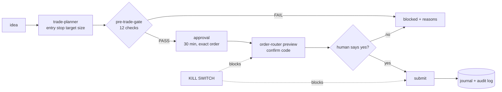

<div align="center">

# tradingkit-skills

**Trading skills for AI agents. Any market. Any broker. Zero API keys to start.**

Turn Claude, Codex, Cursor or Gemini CLI into a disciplined trading co-pilot: analyse charts, scan for setups,
plan trades with exact stops and sizes, enforce your risk rules, backtest ideas, simulate outcomes,
journal everything and route orders - paper by default, live with confirmation.

[](https://github.com/reddygopalkrishna/tradingkit-skills/actions/workflows/ci.yml)
[](LICENSE)


[](https://agentskills.io)

</div>

*An illustrative session:*

```text
You:    Scan my watchlist for breakouts, plan the best one with 1% risk and check it against my rules.
Agent:  [chart-patterns] 3 live setups. NVDA bull flag scores 84 (pivot 131.20, stop 124.60).
        [market-regime] S&P 500: uptrend, selective -> exposure 75%.
        [trade-planner] Buy-stop 131.33, stop 124.60 (structure, 1.4x ATR), target 147.50 (2.4R),
                        size 111 shares = 0.75% risk after regime scaling.
        [pre-trade-gate] PASS - 12/12 checks. Approval A3f9... valid 30 min.
        [order-router]   Preview: BUY 111 NVDA stop @ 131.33, SL 124.60, TP 147.50 [PAPER]
                         CONFIRM CODE: 7KQ2XD - reply "confirm" to place it.
```

## Why this pack

| | typical trading skill packs | **tradingkit-skills** |
|---|---|---|
| Markets | one country / one asset class | **any**: global stocks, ETFs, indices, FX, futures, crypto |
| Data | paid API key required | **free by default** (Yahoo), or your CSVs, or your broker |
| Broker | one, or none | **paper broker built in** + live adapters (Zerodha Kite first) |
| Math | the model "estimates" | **deterministic Python**: every number is computed, tested and reproducible |
| Risk | advice in prose | **hard gate**: no stop, too big, over-heated, daily loss hit -> order is blocked |
| Orders | fire-and-forget | **preview -> human confirm code -> submit**, kill switch, audit log |
| Install | pip/npm dependencies | **zero dependencies**, Python standard library only |
| Portability | one agent | open [Agent Skills](https://agentskills.io) format: Claude Code, claude.ai, Codex, Cursor, Gemini CLI |

## The 15 skills

| | skill | what it does |
|---|---|---|
| 🧭 | [trading-navigator](skills/trading-navigator) | Start here. Routes any trading goal to the right skill; daily brief (regime, risk, positions vs stops, scans, patterns) built for scheduled runs |
| ⚙️ | [trading-setup](skills/trading-setup) | Account, currency, benchmark, risk limits, data provider, broker login, live switch |
| 📈 | [market-data](skills/market-data) | OHLCV bars and quotes for any symbol, daily to 1-minute, CSV export, caching |
| 🔬 | [technical-analysis](skills/technical-analysis) | Trend stage, MAs, RSI, MACD, ADX, ATR, squeeze, Supertrend, OBV, S/R levels, daily vs weekly, explained bias score |
| 🧩 | [chart-patterns](skills/chart-patterns) | VCP, breakout on volume, bull flag, cup & handle, double bottom, inside bar, NR7, pocket pivot - with pivot and stop |
| 🌊 | [market-regime](skills/market-regime) | Risk-on / choppy / correction / risk-off from trend, volatility, drawdown and breadth -> suggested exposure |
| 🔎 | [stock-screener](skills/stock-screener) | Plain-English ideas -> safe rule language; 14 presets (trend template, momentum, squeeze, golden cross...) |
| 🗺️ | [trade-planner](skills/trade-planner) | Entry, stop options, targets, R:R, invalidation and size; futures multipliers, fractional crypto, regime scaling |
| ⚖️ | [position-sizer](skills/position-sizer) | Fixed-fractional, lots and margin, size tables, Kelly, volatility targeting, risk of ruin |
| 🛡️ | [pre-trade-gate](skills/pre-trade-gate) | 12 hard checks against your limits; issues the approval the router requires; live risk dashboard |
| 🧪 | [backtester](skills/backtester) | Portfolio backtests with no look-ahead, costs, stops/targets/trails, ranking, out-of-sample split, HTML report |
| 🎲 | [monte-carlo-sim](skills/monte-carlo-sim) | Odds a setup hits target before stop; drawdown and ruin ranges from your trade history |
| 📓 | [trade-journal](skills/trade-journal) | SQLite journal: plans, fills, R-multiples, grades, notes; CSV import/export |
| 📊 | [performance-review](skills/performance-review) | Stats by setup/side/month, coaching on leaks (cutting winners, holding losers, ignored stops), HTML report |
| 🚦 | [order-router](skills/order-router) | Paper (default) or live orders with preview + confirm code, OCO stop/target, GTT stops, kill switch, audit log |

## Install

**Claude Code (plugin marketplace)**
```bash
/plugin marketplace add reddygopalkrishna/tradingkit-skills
/plugin install tradingkit-skills@tradingkit-skills
```

**Any agent via [skills.sh](https://skills.sh)** (Claude Code, Codex, Cursor, Gemini CLI, and more)
```bash
npx skills add reddygopalkrishna/tradingkit-skills
```

**claude.ai / Claude desktop** - download `.skill` files from the [latest release](https://github.com/reddygopalkrishna/tradingkit-skills/releases),
then upload under *Customize -> Skills* (code execution must be enabled).

**Manual**
```bash
git clone https://github.com/reddygopalkrishna/tradingkit-skills
cp -r tradingkit-skills/skills/* ~/.claude/skills/        # or ~/.codex/skills, ~/.cursor/skills, ~/.gemini/skills
```

Requires Python 3.9+. Nothing to `pip install`.

## Quick start

> **New here? Read the [full usage guide](docs/USAGE.md)**: install, first paper trade in 10 minutes,
> symbols for every market, every skill's commands, live trading setup, scheduling and troubleshooting.

```bash
cd skills/trading-setup
python3 scripts/setup.py doctor                                            # check your machine
python3 scripts/setup.py init --equity 50000 --currency USD --benchmark SPY  # your account and market
```

Then talk to your agent:

```text
"Set up tradingkit-skills: 50,000 USD account, benchmark SPY, risk 1% per trade."
"How's the market?"                          "Analyze AAPL - daily and weekly."
"Find stocks in my watchlist near 52-week highs on rising volume."
"Is NVDA forming a VCP or a flag?"           "Plan a long in MSFT with a 2 ATR stop."
"Backtest buying RSI(2) < 10 above the 200-day on these 20 stocks since 2012, out-of-sample from 2021."
"What are the odds my 2R target hits before the stop?"
"Paper-buy it."                               "Review my trades this month."
```

Or run any skill directly:

```bash
cd skills/technical-analysis && python3 scripts/analyze.py AAPL
cd skills/backtester && python3 scripts/backtest.py --spec assets/strategies/donchian-breakout.json \
    --universe SPY,QQQ,GLD,TLT --start 2008-01-01 --oos-start 2018-01-01 --report donchian.html
```

## What you can trade

Not just stocks. Anything with price bars works, on most exchanges in the world:

| asset | examples (Yahoo format) |
|---|---|
| Stocks and ETFs | `AAPL`, `SPY`, `RELIANCE.NS`, `HSBA.L`, `SAP.DE`, `7203.T`, `0700.HK`, `BHP.AX` |
| Indices | `^GSPC`, `^NDX`, `^NSEI`, `^FTSE`, `^N225` |
| Crypto | `BTC-USD`, `ETH-USD`, `SOL-USD` |
| Forex | `EURUSD=X`, `USDJPY=X`, `USDINR=X` |
| Futures (continuous) | `ES=F`, `NQ=F`, `GC=F`, `CL=F` |

Position sizing handles shares, futures lots and multipliers, and fractional crypto. Bring your own CSVs for
anything else. Options are on the roadmap.

## What it costs

| piece | cost |
|---|---|
| All 15 skills | **free** (MIT) |
| Market data (Yahoo Finance, default) | **free**, no key - unofficial endpoint, may be delayed or rate-limited |
| Your own CSV data | free |
| Paper trading | **free** - built-in simulated broker |
| Zerodha Kite orders | free "Personal" API plan |
| Zerodha Kite market data (optional) | paid "Connect" plan |

You can analyse, screen, backtest, simulate, journal and paper-trade without spending anything or creating a single account.

## Safety model



- **Paper by default.** Live orders need `live on --i-understand-the-risks` *and* a live broker.
- **No approval, no order.** The router refuses opening orders without a fresh gate PASS for that exact symbol/side/qty/stop.
- **Human in the loop.** Every submission needs a single-use confirm code shown in a preview.
- **Kill switch** halts all submissions; `--flatten` closes paper positions and cancels live orders.
- **Audit log** of every preview, submit, cancel and gate decision in `~/.tradingkit-skills/audit.log`.
- **Your limits, enforced:** risk per trade, position size, portfolio heat, max positions, daily loss, losing streak, drawdown, minimum R:R.

Automation-friendly by design: schedule the brief, scans, paper fill processing and weekly reviews.
Live order submission deliberately keeps a human confirmation step. See
[workflows](skills/trading-navigator/references/workflows.md).

## Architecture

```text
skills/<name>/SKILL.md            instructions the agent reads (Agent Skills format)
skills/<name>/scripts/*.py        CLI tools the agent runs (JSON or markdown output)
skills/<name>/scripts/_vendor/    vendored copy of core/tradekit (generated)
core/tradekit/                    zero-dependency engine shared by all skills
  data.py       providers (yahoo, csv, kite) + cache      indicators.py  25+ indicators
  expr.py       safe rule language (AST whitelist)        patterns.py    pattern detectors
  analysis.py   snapshot, levels, regime                  risk.py        sizing math
  backtest.py   portfolio backtester                      montecarlo.py  simulations
  gate.py       risk gate + approvals + audit             journal.py     SQLite journal
  brokers/      paper.py, kite.py (Broker interface)      report.py      HTML/SVG reports
~/.tradingkit-skills/                config, secrets (chmod 600), cache, journal, paper account, audit log
```

Each skill works installed on its own; `tools/sync_core.py` vendors the core into every skill and CI fails if a copy drifts.

## Roadmap

**v0.1.0** (this release) ships the 15 core skills. Later releases add the next waves (contributions welcome):

- **Brokers & data:** Alpaca, Interactive Brokers, crypto exchanges via CCXT, Upstox, Angel One, Fyers, Binance; Kite live ticks
- **Research:** walk-forward optimizer, parameter-robustness heatmaps, overfitting checks (deflated Sharpe, PBO), forward paper-trading runner
- **Analysis:** relative-strength ranking, sector rotation, fundamentals snapshot, news & sentiment, earnings/event calendar, intraday scanner (ORB, VWAP)
- **Risk & portfolio:** portfolio risk (correlation, VaR), options strategy builder (payoff, Greeks), rebalancer, recurring-investment planner, alerts (Telegram/email/webhook)

## Contributing

PRs welcome - new broker adapters, indicators, patterns and presets especially. Read [CONTRIBUTING.md](CONTRIBUTING.md).
Edit `core/tradekit/`, run `python3 tools/sync_core.py`, then `python3 tools/validate_skills.py` and
`python3 -m unittest discover -s tests`. Everything runs offline.

If this saves you time, **star the repo** - it helps other traders find it.

## Disclaimer

Educational and research software. **Not financial advice.** Trading involves substantial risk of loss,
including loss of more than your initial investment with leveraged products. Backtests and simulations describe
the past and are not predictions. Free market data can be delayed or wrong. You are solely responsible for
every decision, order and outcome, and for complying with your broker's and regulator's rules (for example,
requirements for API trading such as registered IPs or algorithm identifiers). Provided "as is" under the MIT
license, without warranty.
