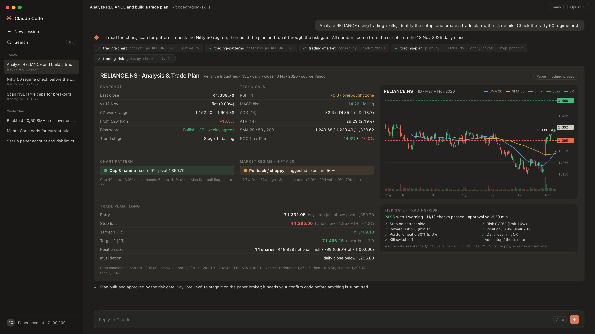
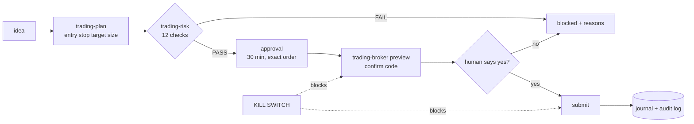

<div align="center">

# trading-skills

**Trading skills for AI agents. Any market. Any broker. Zero API keys to start.**

Turn Claude, Codex, Cursor or Gemini CLI into a disciplined trading co-pilot for any market - US, India
(NSE/BSE), UK, Europe, Asia, crypto, forex: scan for setups, read the news and results, track insider and
Congress trades, time the entry bar by bar, plan exact stops and sizes, enforce your risk rules, check the
odds, set alerts, journal everything and route orders - paper by default, live only with your confirmation.

[](https://github.com/reddygopalkrishna/trading-skills/actions/workflows/ci.yml)
[](LICENSE)


[](https://agentskills.io)



<sub>Real output on the 13 Nov 2026 NSE close: chart read, cup &amp; handle (score 91), Nifty 50 regime, plan and risk gate. Paper account, nothing placed.</sub>

</div>

### One real morning, start to finish

Reliance Industries on NSE, Friday 13 November 2026. The news, results, deals, entry and size lines are real tool
output on that day's data (the replay data ships in `tests/fixtures/live`, so you can run it yourself); the risk,
broker and alert lines show the steps that follow, on paper.

```text
You:    What's new on RELIANCE.NS, and how were its last results?
Agent:  [trading-news]      1,339.70 INR, flat vs yesterday. New since your last check: "Reliance Industries
                            shares jump 15% adding Rs 2,37,767 cr market value" (NewsBytes, 21:25) ...
        [trading-earnings]  Sep-26 quarter: revenue Rs 3,30,601 cr, operating margin 12.5% (10.5% in Jun-26),
                            net income Rs 25,548 cr. Last four quarters: EPS 60.68.
        [trading-insiders]  No bulk or block deal in RELIANCE today. Biggest on NSE: SVF II Meerkat sold
                            7.64 cr MEESHO shares @ 246.75 = Rs 1,885 cr.

You:    Watch it for an opening-range breakout.
Agent:  [trading-entry]     Opening range 09:15-09:30: high 1,333.40, low 1,324.30.
                            09:58  WAITING: 09:50 bar closed 1,332.40, 1.00 under the level. 09:55 bar still forming.
                            10:05  TRIGGERED: the 10:00 bar closed at 1,334.00, above 1,333.40. Nothing was placed.
                            Stop ideas: range midpoint 1,328.85, far side 1,324.30.
        [trading-size]      Rs 5,00,000 account, 0.5% risk, 20% position cap -> 74 shares (Rs 98,716).
                            Binding constraint: position cap - an intraday stop this tight would need 485 shares.
        [trading-risk]      PASS -> approval valid 30 min for exactly this order.
        [trading-broker]    Preview: BUY 74 RELIANCE, SL 1,328.85 [PAPER]. Confirm code shown - reply "confirm".
        [trading-alerts]    Stop, target and "10 min before NSE closes" alerts set.
```

The same flow works for `AAPL` on Nasdaq (that morning its 15-minute range broke to the *short* side at 10:15
ET, 357.69), `SHEL.L` in London or `BTC-USD`.

## Why this pack

| | typical trading skill packs | **trading-skills** |
|---|---|---|
| Markets | one country / one asset class | **any**: global stocks, ETFs, indices, FX, futures, crypto |
| Data | paid API key required | **free by default** (Yahoo), or your CSVs, or your broker |
| Broker | one, or none | **paper broker built in** + live adapters for Zerodha Kite, Fyers, Upstox, Dhan and Groww (one small interface) |
| Math | the model "estimates" | **deterministic Python**: every number is computed, tested and reproducible |
| Risk | advice in prose | **hard gate**: no stop, too big, over-heated, daily loss hit -> order is blocked |
| Orders | fire-and-forget | **preview -> human confirm code -> submit**, kill switch, audit log |
| Install | pip/npm dependencies | **zero dependencies**, Python standard library only |
| Portability | one agent | open [Agent Skills](https://agentskills.io) format: Claude Code, claude.ai, Codex, Cursor, Gemini CLI |

## The 21 skills

| stage | skill | what it does |
|---|---|---|
| start | 🧭 [trading-start](skills/trading-start) | Start here. Routes any goal to the right skill; daily brief (regime, risk, positions vs stops, scans, patterns) for scheduled runs |
| | ⚙️ [trading-setup](skills/trading-setup) | Account, currency, benchmark, risk limits, data provider, broker login, live switch |
| | 📈 [trading-data](skills/trading-data) | OHLCV bars and quotes for any symbol, daily to 1-minute, CSV export, caching |
| find | 🌊 [trading-market](skills/trading-market) | Risk-on / choppy / correction / risk-off from trend, volatility, drawdown and breadth -> suggested exposure |
| | 🔎 [trading-scanner](skills/trading-scanner) | Plain-English ideas -> safe rule language; 14 presets (trend template, momentum, squeeze, golden cross...) |
| | 🧩 [trading-patterns](skills/trading-patterns) | VCP, breakout on volume, bull flag, cup & handle, double bottom, inside bar, NR7, pocket pivot - with pivot and stop |
| research | 🔬 [trading-chart](skills/trading-chart) | Trend stage, MAs, RSI, MACD, ADX, ATR, squeeze, Supertrend, OBV, S/R levels, daily vs weekly, explained bias score |
| | 📰 [trading-news](skills/trading-news) | **New.** Only what is new since your last check, tagged and timed: Google News (every market), Yahoo, SEC 8-Ks; MOVING flags |
| | 💰 [trading-earnings](skills/trading-earnings) | **New.** Quarterly revenue, margins, EPS vs a year ago, TTM, one-off flags - any market (Yahoo) and SEC filings for US |
| | 🕵️ [trading-insiders](skills/trading-insiders) | **New.** US Congress trades (Pelosi tracker, read from the PDFs), SEC Form 4, India NSE bulk/block deals and SEBI insider trades |
| time | ⏱️ [trading-entry](skills/trading-entry) | **New.** Bar-by-bar entry timer: opening-range or level breaks, long or short, volume check, any exchange's session, replays |
| plan | 🗺️ [trading-plan](skills/trading-plan) | Entry, stop options, targets, R:R, invalidation and size; futures multipliers, fractional crypto, regime scaling |
| | 🧮 [trading-fno](skills/trading-fno) | **New.** F&O analysis: option Greeks, implied volatility, multi-leg payoff (spreads, straddles, iron condor), chain OI / PCR / max pain. US live (Cboe, delayed); India from the NSE chain CSV you download or Kite. Analysis only |
| | 🎲 [trading-odds](skills/trading-odds) | Odds a setup hits target before stop; drawdown and ruin ranges from your trade history |
| | ⚖️ [trading-size](skills/trading-size) | Fixed-fractional, lots and margin, size tables, Kelly, volatility targeting, risk of ruin |
| protect | 🛡️ [trading-risk](skills/trading-risk) | 12 hard checks against your limits; issues the approval the broker step requires; live risk dashboard |
| execute | 🚦 [trading-broker](skills/trading-broker) | Paper (default) or live orders with preview + confirm code, OCO stop/target, GTT stops, kill switch, audit log |
| | 🔔 [trading-alerts](skills/trading-alerts) | **New.** Price, stop/target, % move, opening bell and before-the-close alerts on each exchange's own clock |
| learn | 📓 [trading-journal](skills/trading-journal) | SQLite journal: plans, fills, R-multiples, grades, notes; CSV import/export |
| | 📊 [trading-review](skills/trading-review) | Stats by setup/side/month, coaching on leaks (cutting winners, holding losers, ignored stops), HTML report |
| | 🧪 [trading-backtest](skills/trading-backtest) | Portfolio backtests with no look-ahead, costs, stops/targets/trails, ranking, out-of-sample split, HTML report |

## Install

**Claude Code (plugin marketplace)**
```bash
/plugin marketplace add reddygopalkrishna/trading-skills
/plugin install trading-skills@trading-skills
```

**Any agent via [skills.sh](https://skills.sh)** (Claude Code, Codex, Cursor, Gemini CLI, and more)
```bash
npx skills add reddygopalkrishna/trading-skills
```

**claude.ai / Claude desktop** - download `.skill` files from the [latest release](https://github.com/reddygopalkrishna/trading-skills/releases),
then upload under *Customize -> Skills* (code execution must be enabled).

**Manual**
```bash
git clone https://github.com/reddygopalkrishna/trading-skills
cp -r trading-skills/skills/* ~/.claude/skills/        # or ~/.codex/skills, ~/.cursor/skills, ~/.gemini/skills
```

Requires Python 3.9+. Nothing to `pip install`.

## Quick start

> **New here? Read the [full usage guide](docs/USAGE.md)**: install, first paper trade in 10 minutes,
> symbols for every market, every skill's commands, live trading setup, scheduling and troubleshooting.

```bash
cd skills/trading-setup
python3 scripts/setup.py doctor                                            # check your machine
python3 scripts/setup.py init --equity 50000 --currency USD --benchmark SPY  # your account and market
```

Then talk to your agent:

```text
"Set up trading-skills: 50,000 USD account, benchmark SPY, risk 1% per trade."
"How's the market?"                          "Analyze AAPL - daily and weekly."
"Find stocks in my watchlist near 52-week highs on rising volume."
"Is NVDA forming a VCP or a flag?"           "Plan a long in MSFT with a 2 ATR stop."
"Backtest buying RSI(2) < 10 above the 200-day on these 20 stocks since 2012, out-of-sample from 2021."
"What are the odds my 2R target hits before the stop?"
"Paper-buy it."                               "Review my trades this month."
```

Or run any skill directly:

```bash
cd skills/trading-chart && python3 scripts/analyze.py AAPL
cd skills/trading-backtest && python3 scripts/backtest.py --spec assets/strategies/donchian-breakout.json \
    --universe SPY,QQQ,GLD,TLT --start 2008-01-01 --oos-start 2018-01-01 --report donchian.html
```

## What you can trade

Not just stocks. Anything with price bars works, on most exchanges in the world:

| asset | examples (Yahoo format) |
|---|---|
| Stocks and ETFs | `AAPL`, `SPY`, `RELIANCE.NS`, `HSBA.L`, `SAP.DE`, `7203.T`, `0700.HK`, `BHP.AX` |
| Indices | `^GSPC`, `^NDX`, `^NSEI`, `^FTSE`, `^N225` |
| Crypto | `BTC-USD`, `ETH-USD`, `SOL-USD` |
| Forex | `EURUSD=X`, `USDJPY=X`, `USDINR=X` |
| Futures (continuous) | `ES=F`, `NQ=F`, `GC=F`, `CL=F` |

Position sizing handles shares, futures lots and multipliers, and fractional crypto. Bring your own CSVs for
anything else. **India:** NSE (`.NS`) and BSE (`.BO`) stocks work in every skill, and live orders go through
your broker's adapter (equity and F&O contracts in the broker's own symbol format). An F&O analysis skill (option chain, Greeks, open
interest, strategies) is on the roadmap - it is not in this release.

## What it costs

| piece | cost |
|---|---|
| All 21 skills | **free** (MIT) |
| Market data (Yahoo Finance, default) | **free**, no key - unofficial endpoint, may be delayed or rate-limited |
| Your own CSV data | free |
| Paper trading | **free** - built-in simulated broker |
| Live orders through your broker | whatever your broker charges for API access (often free for orders) |
| Live market data from your broker (optional) | your broker's data plan, if it has one |

You can analyse, screen, backtest, simulate, journal and paper-trade without spending anything or creating a single account.

## Safety model



- **Paper by default.** Live orders need `live on --i-understand-the-risks` *and* a live broker.
- **No approval, no order.** The router refuses opening orders without a fresh gate PASS for that exact symbol/side/qty/stop.
- **Human in the loop.** Every submission needs a single-use confirm code shown in a preview.
- **Kill switch** halts all submissions; `--flatten` closes paper positions and cancels live orders.
- **Audit log** of every preview, submit, cancel and gate decision in `~/.trading-skills/audit.log`.
- **Your limits, enforced:** risk per trade, position size, portfolio heat, max positions, daily loss, losing streak, drawdown, minimum R:R.

Automation-friendly by design: schedule the brief, scans, paper fill processing and weekly reviews.
Live order submission deliberately keeps a human confirmation step. See
[workflows](skills/trading-start/references/workflows.md).

## Architecture

```text
skills/<name>/SKILL.md            instructions the agent reads (Agent Skills format)
skills/<name>/scripts/*.py        CLI tools the agent runs (JSON or markdown output)
skills/<name>/scripts/_vendor/    vendored copy of core/tradekit (generated)
core/tradekit/                    zero-dependency engine shared by all skills
  data.py       providers (yahoo, csv, broker) + cache    indicators.py  25+ indicators
  expr.py       safe rule language (AST whitelist)        patterns.py    pattern detectors
  analysis.py   snapshot, levels, regime                  risk.py        sizing math
  backtest.py   portfolio backtests                        montecarlo.py  simulations
  gate.py       risk gate + approvals + audit             journal.py     SQLite journal
  brokers/      paper broker + live adapters (one interface) report.py   HTML/SVG reports
  feeds.py      news feeds, tags, "only new" state        fundamentals.py quarterly results (Yahoo)
  sec.py        SEC EDGAR filings, XBRL, Form 4           disclosures.py Congress PTRs (PDF), NSE deals, SEBI PIT
  session.py    exchange sessions + entry triggers        alerts.py      alert rules and evaluation
~/.trading-skills/                config, secrets (chmod 600), cache, journal, paper account, audit log
```

Each skill works installed on its own; `tools/sync_core.py` vendors the core into every skill and CI fails if a copy drifts.

## FAQ

**Is there a free trading skill pack for Claude Code, Codex, Cursor or Gemini CLI?**
Yes. trading-skills is free and MIT licensed, with 21 skills in the open Agent Skills format. Install with
`npx skills add reddygopalkrishna/trading-skills`.

**Does it need an API key or a paid data subscription?**
No. It uses free Yahoo Finance data and a built-in paper broker by default. A broker account is only needed for
live orders.

**Which markets and brokers does it support?**
Any market Yahoo covers (US, India, UK, Europe, Japan, Hong Kong, Canada, Australia and more), plus forex, crypto,
indices and futures, or your own CSV data. Brokers: the built-in paper broker, plus live adapters for the Indian brokers with an official API - Zerodha Kite,
Fyers, Upstox, Dhan and Groww (all but Kite are beta: written against the official docs, tested offline, not yet
run against live accounts). Angel One is not supported yet. See [the usage guide](docs/USAGE.md#7-live-trading-through-a-broker).

**Can an AI agent place trades on its own with this?**
Not live trades. Every opening order needs a passing pre-trade risk gate and a one-time confirm code that you
approve. Paper trading is the default.

**How is this different from asking a chatbot for trade ideas?**
The model never estimates numbers. Indicators, patterns, position sizes, backtests and probabilities come from
tested Python code, so results are reproducible.

**Does it work for the Indian market?**
Yes. Use NSE (`RELIANCE.NS`) or BSE (`RELIANCE.BO`) symbols in every skill. The entry timer and alerts read NSE's
09:15-15:30 session from the data, earnings show Rs crore, news uses Google News India, and the insider skill
reads NSE bulk/block deals and SEBI insider disclosures. Analysis works whichever broker you use; live orders
go through a broker adapter.

**Can it track what Nancy Pelosi and other members of Congress buy?**
Yes - `trading-insiders congress --member pelosi --new --read` reads each new House report straight from the
PDF (owner, ticker, buy/sell, option strike and expiry, amount range, days to disclose). These are public
filings made weeks after the trade: fast, not early.

**Will it make me money?**
No tool can promise that, and most active traders lose money. These skills make the process disciplined:
every trade has a stop, a size, a risk check and your confirmation. Practise on paper first.

More in the [usage guide FAQ](docs/USAGE.md#12-faq).

## Roadmap

**v0.3.0** (this release): 21 skills - adds `trading-fno` (option Greeks, IV, payoff, OI / PCR / max pain) and
Fyers, Upstox, Dhan and Groww adapters; v0.2.0 added news, earnings, insider and Congress trades, the entry timer, alerts
and the `trading-` skill names. Next (contributions welcome):

- **F&O:** `trading-fno` covers option chains, Greeks, OI / PCR / max pain and payoff. Still to do: a live NSE chain feed (nseindia.com blocks programs), futures basis and roll, order legs for multi-leg strategies
- **Brokers & data:** Angel One, US and crypto-exchange adapters, live-verifying the beta adapters, and live tick feeds
- **Alerts out:** Telegram, email and webhook delivery
- **Research:** walk-forward optimizer, robustness heatmaps, overfitting checks, forward paper-trading runner
- **Portfolio:** correlation and VaR, sector rotation, rebalancer

## Contributing

PRs welcome - new broker adapters, indicators, patterns and presets especially. Read [CONTRIBUTING.md](CONTRIBUTING.md).
Edit `core/tradekit/`, run `python3 tools/sync_core.py`, then `python3 tools/validate_skills.py` and
`python3 -m unittest discover -s tests`. Everything runs offline.

If this saves you time, **star the repo** - it helps other traders find it.

## Disclaimer

Educational and research software. **Not financial advice.** Trading involves substantial risk of loss,
including loss of more than your initial investment with leveraged products. Backtests and simulations describe
the past and are not predictions. Free market data can be delayed or wrong. You are solely responsible for
every decision, order and outcome, and for complying with your broker's and regulator's rules (for example,
requirements for API trading such as registered IPs or algorithm identifiers). Provided "as is" under the MIT
license, without warranty.
